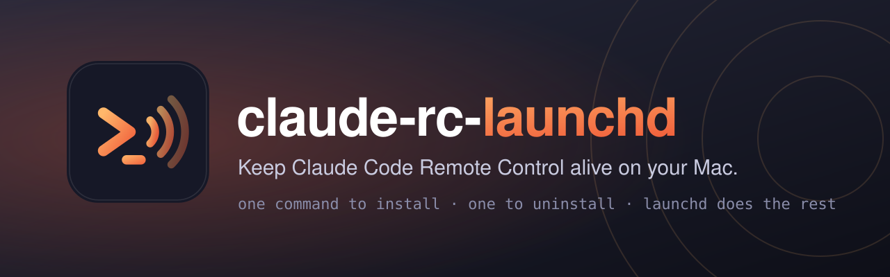

<p align="center"><b>English</b> · <a href="README.zh-CN.md">简体中文</a></p>

<p align="center"></p>

<p align="center">
  <a href="LICENSE"></a>
  <a href="https://github.com/sicaboy/claude-code-remote-control-launchd/actions/workflows/ci.yml"></a>
  
  
  
  <a href="https://github.com/sicaboy/claude-code-remote-control-launchd/pulls"></a>
</p>

# Claude Code Remote Control for macOS

Run [Claude Code](https://code.claude.com) **Remote Control** (`claude remote-control`) as an always-on macOS background service (launchd LaunchAgent). Your Mac shows up as a **device card** in the Claude app's Code tab (and on claude.ai/code), so you can start new, independent sessions on it from your phone at any time, without leaving a terminal open.

It is a small LaunchAgent plus a supervisor script. It starts at login, restarts the server when it exits, and refuses to flap.

> Unofficial community project, not affiliated with or endorsed by Anthropic.

## Install (one command)

```bash
curl -fsSL https://raw.githubusercontent.com/sicaboy/claude-code-remote-control-launchd/main/install.sh | bash -s -- --workdir ~/projects --name "My Mac"
```

or from a clone:

```bash
git clone https://github.com/sicaboy/claude-code-remote-control-launchd && cd claude-code-remote-control-launchd
./install.sh --workdir ~/projects --name "My Mac"
```

| Option | Default | Meaning |
| --- | --- | --- |
| `--workdir DIR` | `~/claude-rc` | Directory sessions start in. Must be **trusted** by Claude Code (see below). Not your home directory. |
| `--name NAME` | the Mac's name | Device name shown in the app |
| `--capacity N` | `10` | Max concurrent sessions. Idle sessions keep their slot, so a full server silently ignores new ones. |
| `--spawn MODE` | `same-dir` | `same-dir` (shared files) or `worktree` (needs a git repo) |

Re-running `install.sh` with new options updates the installation in place.

**Before you install:** be signed in (`claude auth login`, a claude.ai account; API keys do not work for Remote Control), and trust the work directory once: `cd ~/projects && claude`, accept the prompt. The installer checks both and tells you what to do.

## Everyday use

```bash
./install.sh status        # job state, config, last log lines
tail -f ~/.local/share/claude-code-remote-control/server.log
```

## Uninstall (one command)

```bash
./uninstall.sh                       # remove job, script, config and logs
./uninstall.sh --keep-logs           # keep the logs
# without a clone:
curl -fsSL https://raw.githubusercontent.com/sicaboy/claude-code-remote-control-launchd/main/install.sh | bash -s -- uninstall
```

Uninstalling stops the server and the sessions it is serving.

## What it does

`~/Library/LaunchAgents/io.github.sicaboy.claude-code-remote-control.plist` runs `claude-code-remote-control.sh` with `RunAtLoad` and `KeepAlive`. Each cycle the script:

1. waits for the network (up to 2 min);
2. checks `claude auth status`; if signed out it logs the fix and holds 5 min instead of hammering;
3. backs off after 3 starts in an hour (5 min per extra start, max 30), so a broken server cannot flap and leave ghost devices on your phone;
4. runs `claude remote-control --spawn <mode> --capacity <n> --name <name>` in your work directory;
5. treats "no established HTTPS connection within 150 s" as stuck (for example an invisible first-run prompt) and restarts it;
6. logs a heartbeat every 5 min, and logs the exit code and last output lines when the server exits.

It scrubs inherited `CLAUDE*`, `ANTHROPIC_API_KEY` and `ANTHROPIC_AUTH_TOKEN` variables first, so it never picks up another session's identity.

Everything lives in `~/.local/share/claude-code-remote-control/`. In System Settings > General > Login Items & Extensions the item appears as `claude-code-remote-control.sh` (not a bare `bash`).

## Limits and notes

- **Sleep.** A sleeping Mac is not reachable. Keeping it awake (power adapter, `caffeinate -s`, Energy settings) is up to you; this tool does not change power settings.
- **Login needed after reboot.** A LaunchAgent runs inside a logged-in session; with FileVault and no auto-login, log in once after a reboot.
- **Sign-in expiry.** Renew with `claude auth login` when it expires. The log shows the expiry date at each start.
- **Restarts end sessions.** Restarting the server (or `install.sh` re-run, or uninstall) stops the sessions it serves. Transcripts stay on disk.
- It relies on `claude remote-control` behaviour in current Claude Code releases; flags may change.

## Development

```bash
bash test/test.sh      # smoke tests against a fake `claude`, no network
shellcheck -x -S warning install.sh scripts/claude-code-remote-control.sh test/test.sh
```

## License

[MIT](LICENSE)
